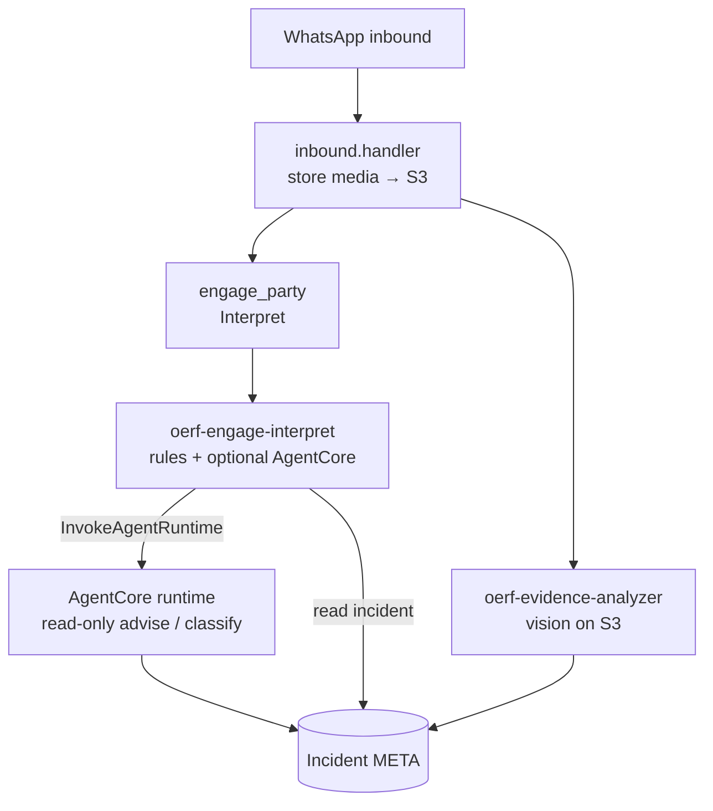

# Approach: AgentCore in OERF (WhatsApp understanding scenarios)

> **Adopted as a planning reference (OERF-215), not a current implementation contract.**
> Source: `/Users/fl_lpt-544/Downloads/agentcore-implementation-approach.md`;
> source SHA-256
> `fe291177a47336296b39de4ce398593064b3c56e7802ceb00af769dabfc0d59e`.
> The source text below is retained, with trailing whitespace normalized for
> Markdown hygiene. Where it conflicts with accepted decisions or shipped behavior, follow [ADR-042](adr/ADR-042-driver-reply-classification.md),
> the frozen [interfaces §9.1](interfaces.md#91-agent-runtime), and the
> [OERF-214 acceptance/runbook record](agentcore.md#oerf-214-dev-acceptance-and-operator-checklist).
>
> **Current reconciliation:** This note’s Sections 2.3, 3, 6, 7, and 9 describe
> pre-OERF-209 gaps/proposals and are historical, not current instructions. Phase 1
> bounded free-text classification is implemented; `inputs.reply_text` is capped
> at 4,000 characters and passed only for `task=interpret`. Deterministic Interpret
> validation owns intent and validity; accepted routes/fallbacks and the synthetic,
> credential-free acceptance evidence are recorded in ADR-042, `interfaces.md`,
> and the OERF-214 runbook. Fault-code answers remain fail-closed pending an
> authoritative tenant catalog. Media interpretation, new workflow states, and
> expanded IAM are not adopted by this note and require separately approved scope.
> Do not use its old claims (including “runtime does not receive the text”) as
> current behavior.

**Status:** Proposed (not implemented beyond current MVP wiring)
**Parent:** Related to desk Settings only indirectly; primary anchor is **engagement Interpret** and ADR-007.
**Related:** [ADR-007-agent-advisory.md](adr/ADR-007-agent-advisory.md), [ADR-020-bedrock-model.md](adr/ADR-020-bedrock-model.md), `docs/interfaces.md` §5 (inbound), §8 (runtimes), §9.1 (Agent runtime), `oerf/platform/cadence/interpret.py`, `oerf/platform/agent/agentcore/`, `oerf/platform/evidence/vision.py`

## 1. Goal

Use **Amazon Bedrock AgentCore** (optional deploy via `agentcore:enabled`) so OERF can **understand** richer driver input on WhatsApp—especially **free text** and **media**—while keeping the product rule:

**AI understands, rules decide, people approve** (ADR-007).

The agent/runtime must **not** send messages, mutate incident state, or hold task tokens. Interpret and downstream **rules** choose intents; the channel router sends **approved** templates.

This document is **planning only**. It prioritizes **minimal, incremental** changes aligned with existing paths rather than a new agent portal or multi-tenant settings work.

## 2. What already exists

### 2.1 Infrastructure (OERF-312)

| Piece | Role |
|-------|------|
| CDK `AgentCoreRuntime` | ARM64 container when `agentcore:enabled=true` |
| `oerf/platform/agent/agentcore/app.py` | `POST /invocations` HTTP entry |
| `oerf-agent-caller` / interpret Lambda | `bedrock-agentcore:InvokeAgentRuntime` when enabled |
| Env | `AGENTCORE_ENABLED`, `AGENT_RUNTIME_ARN` on `oerf-engage-interpret` |

Default synth: **off** (no image build). Dev deploy often passes `agentcore:enabled=true`.

### 2.2 Runtime behaviour today (OERF-206)

On invoke, the runtime:

1. Validates envelope: `tenant_id`, `incident_id`, `task`, `inputs`, `trace_id`.
2. **Read-only** load incident + tenant config (`decision.py`, `advisory.py`).
3. Optional **Strands + Nova Lite** note from **incident state + verified fault codes** — **not** from the driver’s WhatsApp body.
4. Returns `Advisory` JSON (`status: advisory` or `placeholder` / `fallback: true`).

**IAM:** Incident/tenant read, `bedrock:InvokeModel`, `bedrock:ApplyGuardrail`. **No** writes, channels, or Step Functions.

### 2.3 Engagement Interpret path (where WhatsApp meets the agent)

```text
Inbound (SQS) → correlate → SendTaskSuccess(workflow + reply)
    → engage_party ASL → Interpret (oerf-engage-interpret)
        → interpret_workflow() → $.response
    → InterpretResult Choice (intent / valid)
```

| Reply type | `map_reply()` | `$.response` | AgentCore called? |
|------------|---------------|--------------|-------------------|
| Template buttons / keywords (`running`, `stopped`, …) | Match | Known intent, `valid: true` | **No** |
| Empty / unknown free text | `None` | `intent: clarify`, `valid: false` | **Yes**, if `AGENTCORE_ENABLED` |
| Free text with meaning | `None` (today) | Same clarify path | **Yes**, but runtime **does not receive the text** |

**Important gap:** `_runtime_advisory()` sends only `tenant_id`, `incident_id`, `task: interpret`. The **driver message is not in the payload**. The model never sees “truck is still moving” etc. Free text still ends on **clarify / ResetLadder** unless rules add new intents.

**Important filter:** `interpret._status_only()` keeps only `status` and `fallback` from the runtime response for `response.advisory` — it **drops** recommended actions from the advisory body (ADR-007).

### 2.4 Media / documents (parallel path, not AgentCore today)

| Step | Component |
|------|-----------|
| Inbound | Stores WhatsApp image/PDF via End User Messaging → evidence S3; puts `media[]` on callback payload (`interfaces.md` §5) |
| Classify | **Interpret** step (not inbound) — intended owner per ADR-017 |
| Analyze | `oerf-evidence-analyzer` (`vision.py`) on S3 **Object Created** (jpeg/png/webp; PDF stored but **not** auto-analyzed) |
| Persist | Writes `evidence_analysis` / `evidence_verification` on **incident META** |
| AgentCore | Reads `evidence_analysis` on **next** invoke — **async**, not same turn as upload |

So scenario (2) is **partially** covered by **vision + rules**, not by AgentCore interpreting bytes directly.

## 3. Design boundaries (do not break)

| Rule | Source |
|------|--------|
| Agent does not send WhatsApp/SMS/email | ADR-007, ADR-008 |
| Agent does not write DynamoDB incident state | `decision.py`, runtime IAM |
| Interpret owns reply **classification** for engagements | `interfaces.md` §5, engage ASL |
| Known buttons/keywords **never** call the model | ADR-007, `interpret.py` |
| No driver text, phone, or image bytes in logs | `logging.py`, `advisory.py` |
| Task tokens only resumed from inbound/dashboard | ADR-028 |

**“Advise accordingly”** in product language means: **narrow intents**, **clarification ladders**, **evidence requests**, and **desk-visible notes**—not open-ended chat or autonomous actions.

## 4. Focus scenarios

### Scenario A — Driver free text on WhatsApp (your #1)

**User story:** Driver replies with arbitrary text during driver check-in / diagnosis engagement. OERF should interpret it and guide the workflow (e.g. running vs stopped vs “need help” vs unclear).

**As-is:**

- Unmapped text → `clarify` → `ResetLadder` → more template nudges.
- AgentCore may run but only enriches from **incident snapshot**, not the reply.

**Target (minimal):**

1. **Pass sanitized reply metadata** in `inputs` (e.g. `reply_kind: text`, `reply_fingerprint` or length-capped tokenized summary — **not** full text in logs; contract defines allowed fields).
2. **Extend `task=interpret`** handling in runtime: classify into a **closed set** of intents aligned with `map_reply` + extensions (`unit_running`, `unit_stopped`, `unknown`, `call_me`, `need_clarification`, …).
3. **Rules merge:** Model suggests; **Interpret Lambda** maps suggestion → `$.response.intent` / `valid` / `fields` only if confidence + guardrail + vocabulary checks pass; else stay on clarify.
4. **Optional advisory note** for desk/timeline (still no outbound generation by agent).

**Non-goals for A:** Open dialogue, LLM-written WhatsApp replies, changing cold-chain state machine from model output.

**Demo / test flows:** `scripts.demo_reply` (mocked/live), engagement on PH-2841 driver check-in, `agentcore:enabled=true`, assert Interpret transitions beyond endless clarify for representative phrases.

---

### Scenario B — Driver photo or document (your #2)

**User story:** Driver sends a photo of a display or a PDF; OERF should interpret and advise (e.g. fault codes, “need clearer photo”).

**As-is:**

- Inbound stores media → callback includes `reply` + media refs.
- Vision Lambda **asynchronously** analyzes images → `evidence_analysis` on incident.
- Interpret today is **text-centric** in `map_reply()`; media replies likely hit **clarify** unless extended.
- AgentCore does **not** call Converse on the image; vision Lambda does.

**Target (minimal — prefer composition over duplicating vision in AgentCore):**

| Phase | Behaviour |
|-------|------------|
| **B1 — Interpret media reply** | If `reply.type` is image/document: set `response.intent` (e.g. `evidence_submitted`), attach `evidence_refs` (S3 key prefixes only), `valid` per policy; **do not** block on vision. |
| **B2 — Wait or poll** | Engagement branch: optional short wait/re-enter Interpret when `evidence_analysis` appears on incident (lifecycle or second callback token) — **product choice** to avoid long SFN waits. |
| **B3 — AgentCore advisory** | When evidence exists, existing `advise()` + model note already use fault codes; extend **inputs** with `evidence_status: pending|ready` so advisory text matches “wait for analysis” vs “catalog mismatch”. |
| **B4 — PDF** | Explicit path: acknowledge store, **no** auto vision; rules ask for photo or human review (already `interfaces.md` posture). |

**Non-goals for B:** Streaming image bytes into AgentCore runtime; model-initiated S3 reads (keep vision on `oerf-evidence-analyzer` role).

---

### Scenario C — Clarification ladder (supporting A)

**User story:** After unclear text, system escalates reminders without “going rogue.”

**As-is:** `ResetLadder` + cadence templates (`driver_reminder`, etc.).

**AgentCore role:** Optional **hint** in advisory (`status` only to parent) whether to continue ladder vs request callback — still **lifecycle** sends templates.

**Priority:** Lower than A/B; mostly already rules-driven.

---

### Scenario D — Ops / facility free text (later)

Same Interpret machinery with **role-specific** intent sets (`facility` acceptance, `ops_manager` approval). Defer until driver path is proven; cadence mapping already role-aware.

## 5. Recommended architecture (incremental)



**Single orchestration principle:** **Interpret Lambda** owns merging rules + model; **AgentCore** stays read-only; **vision** stays on evidence analyzer.

## 6. Contract changes (when implementing)

Additive `docs/interfaces.md` minor bump:

| Area | Change |
|------|--------|
| Invoke payload `inputs` | Document optional `reply` summary fields (text hash/length, type, media ref ids) — never log raw values |
| `task` enum | `interpret` (existing); optional `interpret_evidence` only if B needs distinct handler |
| `$.response` | Optional `advisory` shape if product wants desk to show sanitized notes (today stripped to status) |
| Timeouts | Align interpret Lambda timeout with runtime idle (60s) / max lifetime (5m) |

Do not widen AgentCore IAM to S3 or Converse unless a separate ADR amends ADR-007.

## 7. Implementation phases (minimal order)

| Phase | Deliverable | Scenarios |
|-------|-------------|-----------|
| **0 — Baseline** | Confirm dev deploy `agentcore:enabled=true`, `AGENTCORE_ENABLED=true`, E2E placeholder/fallback | Smoke |
| **A0 — Wire reply into invoke** | Interpret passes safe `inputs` from `workflow.reply`; runtime envelope validation; tests with synthetic text | A |
| **A1 — Constrained classification** | Runtime or interpret-side mapper: free text → allowed intents; guardrail; no new outbound | A |
| **A2 — Product intents** | Map new intents in `engage_party.asl.json` **only** where rules sign off (e.g. treat “call me” variants) | A |
| **B1 — Media branch in Interpret** | Non-text reply handling + `evidence_refs` | B |
| **B2 — Vision coordination** | Document/demo: text reply after image once `evidence_analysis` set; optional small lifecycle hook | B |
| **—** | Desk timeline showing sanitized advisory | Optional polish |

**Defer:** Multi-domain agents, Settings UI, tenant provisioning ([desk-settings-approach.md](desk-settings-approach.md)).

## 8. Testing strategy

| Layer | Approach |
|-------|----------|
| Unit | `interpret_workflow` with fake `consult`; no AWS credentials |
| Unit | `decision.advise`, `agentcore.app.handle` with fake incident reader |
| Unit | Vision + interpret integration with mocked evidence on incident |
| Security | `@pytest.mark.security` — no reply body in logs; tenant mismatch refused |
| Synth | `cdk synth -c agentcore:enabled=true` (CI already does) |
| Live | `@pytest.mark.aws` opt-in; dev rehearsal with live WhatsApp + AgentCore |

## 9. Acceptance criteria (MVP for your two scenarios)

**A — Free text**

1. With AgentCore enabled, a driver free-text reply that clearly indicates “unit running” (per approved test phrases) yields `$.response.valid: true` and intent `unit_running` **without** the agent sending any message.
2. Ambiguous text yields clarify path or safe fallback; runtime failure yields `fallback: true` and rules-only behaviour (ADR-007).
3. Button replies still **never** invoke AgentCore.

**B — Photo / document**

1. Image reply stores to evidence bucket; Interpret records `evidence_submitted` (or equivalent) with refs; engagement does not crash.
2. After vision writes `evidence_analysis`, a subsequent advisory or interpret pass reflects known/unknown fault codes per tenant catalog (`decision.py` policy).
3. PDF stored but no auto vision; rules request clearer evidence or human path.

## 10. Open questions

1. Should classification happen **inside** AgentCore or in **interpret** with a small Bedrock call on the Lambda role? (Minimal change: extend runtime; smallest blast radius: interpret-only Converse with same guardrails.)
2. Should desk/incident timeline show **full advisory** or keep status-only strip?
3. For B, is **one-shot** interpret enough for hackathon, or is **wait-for-vision** required in SFN?
4. Exact **phrase list** vs **semantic** classification for driver diagnosis (demo scripts vs production)?

## 11. Suggested commit themes

- `feat(interpret): pass engagement reply into AgentCore inputs (sanitized)`
- `feat(agentcore): constrained free-text intent for driver interpret`
- `feat(interpret): media reply evidence_refs and clarify handling`

---

*Planning only. Behaviour changes must respect ADR-007, `interfaces.md`, and owner boundaries (agentcore/interpret: coordinate with project lead + Ananda for infra/IAM).*
