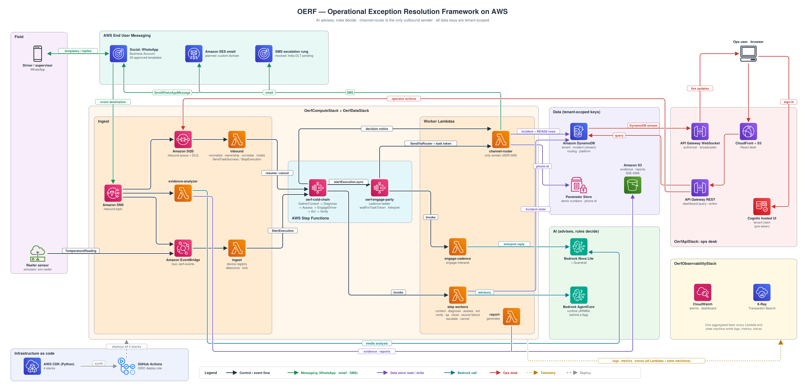
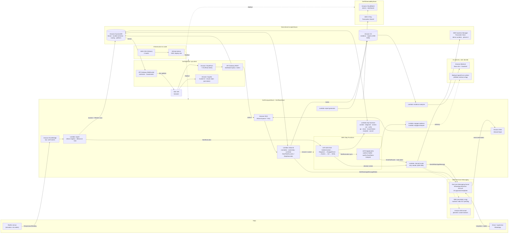

# Architecture

The drawing lists Assess before the driver engagement. The deployed `oerf-cold-chain` machine runs EngageDriver first, then Assess. The diagram below follows the machine.

A reefer reading becomes an incident, a WhatsApp conversation, and a live desk. The sensor path is EventBridge, then ingest, then Step Functions. The channel router sends through AWS End User Messaging Social. The driver replies, inbound resumes the waiting step, and the workflow sends an acknowledgement and, after the rules choose, a decision notice. The incident stream updates the desk. Bedrock AgentCore interprets a free-text reply. Amazon Nova Lite on Bedrock reads evidence photos. Rules decide. The model advises.

The same diagram as a drawing file: [SVG](images/architecture.svg).

## Flow

The cold-chain label follows the deployed state machine. Assess runs after the driver engagement returns. An earlier sketch put Assess first.

1. The simulator (`sim.reefer`) publishes `TemperatureReading` to the bus `oerf-events`.
2. Ingest reads the device registry, debounces, takes the shipment lock, writes the incident, and starts `oerf-cold-chain`.
3. After Diagnose, the cold-chain machine starts `oerf-engage-party` and waits for it. The engagement sends through the channel router and pauses on a task token.
4. End User Messaging Social delivers the WhatsApp template. The driver's reply arrives on the inbound topic and queue.
5. Inbound deduplicates, checks ownership, and calls `SendTaskSuccess`. Interpret maps buttons and keywords itself. Free text may ask AgentCore, which returns an advisory and does not choose the intent.
6. A valid reply gets an acknowledgement through the router (`Thanks, noted: …`). Assess then ranks options from the rules. Act follows that ranking. The router sends the decision notice: continue, or divert to a facility.
7. The incident stream updates the desk over WebSocket. An operator can confirm, pick an option, or cancel. Those actions re-enter through the inbound queue. Cancel stops the execution.

## Stacks

CDK (Python) deploys four stacks in us-east-1. There is no VPC. GitHub Actions assumes an OIDC deploy role. The data stack does not depend on the compute stack: state machines refer to Lambda functions by name.

| Stack | What it holds |
| --- | --- |
| `OerfDataStack` | Four DynamoDB tables, evidence and report buckets, Cognito (tenant claim and pre-token trigger), `oerf-cold-chain`, `oerf-engage-party`, the deploy role. |
| `OerfComputeStack` | Ingest, the step and engagement functions, the channel router, inbound, evidence analyzer, report generator, the HTTP API (GET), and the WebSocket API and broadcaster. |
| `OerfApiStack` | The desk: CloudFront, the React app, and the REST API for query and action. Synth includes it when `dashboard:enabled` is true. |
| `OerfObservabilityStack` | Alarms and the operations dashboard. |

Decisions are indexed in [docs/adr/README.md](adr/README.md). The wire contract is [docs/interfaces.md](interfaces.md).

## What is live, mocked, and planned

| Piece | Today |
| --- | --- |
| Sensor to incident | Live path: EventBridge, ingest, the shipment lock, `StartExecution`. The sensor is the simulator. |
| Cold-chain steps | GatherContext, Diagnose, Assess, Act, Verify, QA, Close, RecordFailure, Escalate, and Cancel have their own functions. OPEN, Approval, SecureFacility, HandleReopen, and GenerateReport still call the shared stub. |
| Engagement | Cadence, interpret, and router sends are live, including the task-token wait. Callback handling, ladder reset, the final question, and the exhaustion action still call the stub. |
| WhatsApp | End User Messaging Social, sent only by the channel router. Mocked unless `channels:live` is true. The event destination is created when a WhatsApp Business account id is set. |
| Acknowledgement and decision notice | The router sends them as one-way WhatsApp messages after a valid reply and after Act. |
| Inbound resume and cancel | Live. Resume is `SendTaskSuccess`. Cancel is `StopExecution` on the cold-chain execution, then `CANCELLED` and the lock is released. |
| SMS | Mocked unless channels are live. A live send is `sns:Publish` from the router. The diagram's dashed SMS rung is that escalation path. |
| Email | The router can send with SESv2 when email is not mocked and a source address is set. A custom sending domain is not configured. |
| Voice | The cadence can name a voice rung. The router does not place a call. The text tells the person to reply on WhatsApp. |
| Evidence | Inbound stores media with `GetWhatsAppMessageMedia`. The analyzer calls Nova Lite and a guardrail when Bedrock is not mocked (`channels:live`). Otherwise it is mocked. |
| AgentCore | Off unless `agentcore:enabled` is true. The runtime is ARM64. It advises. Interpret keeps the rule result. |
| Desk | The React desk, Cognito hosted UI, REST query and action, and the WebSocket updates. The API stack is behind `dashboard:enabled`. |
| Reports | `oerf-report-generator` is deployed and writes HTML, or PDF when WeasyPrint is selected. The GenerateReport state still calls the stub, so the machine does not invoke that function yet. |
| Encryption | AWS managed keys. Table encryption with the managed KMS key is behind `dynamodb:kmsManaged` and defaults off ([ADR-033](adr/ADR-033-encryption-at-rest.md)). |

Document extraction and audio transcription are not in this release. There is no second region.
