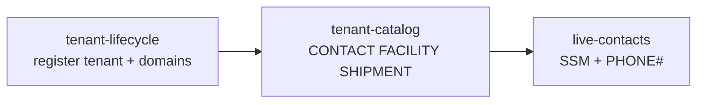

# Desk Settings: planning overview

**Status:** Proposed (not implemented)  
**Audience:** Anyone implementing operator/tenant-admin tooling on the OERF desk

This page is the **index** for Settings-related work. Detailed design lives in three companion documents so overlap stays minimal.

## 1. What “Settings” means here

A single **Settings** area in the React desk (`web/`) for work that today requires **repo JSON**, **`scripts.seed_runtime`**, or **`aws ssm put-parameter`**. It is **not** a full self-service SaaS onboarding portal (see [tenant-lifecycle-approach.md](tenant-lifecycle-approach.md)).

Typical actors:

| Role | Scope |
|------|--------|
| `tenant_admin` | Their tenant’s reference data, domain config, live demo numbers |
| `platform_admin` | Cross-tenant admin routes where the API allows (`_admin_tenant`) |
| `ops_user` | Incidents only; Settings write UI is out of scope unless product adds read-only status |

## 2. Document map

| Document | Scope | Out of scope |
|----------|--------|----------------|
| [settings-tenant-catalog-approach.md](settings-tenant-catalog-approach.md) | Move **`sim/seed`** content into **DynamoDB**; CRUD for contacts, facilities, shipments, fault codes, domain config/cadence via desk | SSM live numbers; creating a new tenant record |
| [settings-live-contacts-approach.md](settings-live-contacts-approach.md) | **Live WhatsApp** rehearsal: SSM SecureStrings + `PHONE#` sync | Contact identity/roles (catalog doc); tenant registration |
| [tenant-lifecycle-approach.md](tenant-lifecycle-approach.md) | **New tenant** provisioning (backend/scripts), **multi-domain** subscription (cold chain vs future domains), Cognito, no onboarding portal for now | Per-field Settings UI for catalogs |

**Read order:** lifecycle (platform) → tenant catalog (data) → live contacts (channels).

## 3. Shared technical constraints

These apply to **all** Settings features:

| Topic | Rule |
|-------|------|
| **Browser** | No AWS SDK. Cognito ID token + REST only (`web/src/session.js`). |
| **Server** | `boto3` in dashboard Lambda (`oerf/platform/api/dashboard.py`). |
| **Tenancy** | `tenant_id` from JWT (`custom:tenant_id`). Path `{tid}` must match claim unless `platform_admin`. Never authorize from request body `tenant_id`. |
| **Logging** | `oerf/platform/observability/logging.py` — no E.164, emails, or message bodies in logs. |
| **API surface** | Extend existing **OerfApiStack** REST admin tree; do not add a second API or Lambda family. |
| **Contract** | Additive bumps to `docs/interfaces.md` per feature. |
| **Prod gap** | `services_from_env()` must wire **repository, catalog, SSM, routing** ports before admin writes persist in AWS (today: incidents + queue only). |

## 4. Settings UI information architecture (target)

One nav entry **Settings** with tabs. Ownership of each tab is split across the child docs:

| Tab | Primary doc | Stores |
|-----|-------------|--------|
| Tenant profile (read-mostly) | lifecycle + catalog | `META` |
| Contacts & parties | catalog | `CONTACT#` |
| Facilities, shipments, fault codes | catalog | `FACILITY#`, `SHIPMENT#`, `FAULTCODE#` |
| Domain config / allowance | catalog | `CONFIG#…` (ADR-013 publish) |
| Cadence | catalog | `CADENCE#…` |
| **Live numbers** | live-contacts | SSM + `PHONE#` |

**Contacts** and **Live numbers** are separate tabs: catalog holds identity, role, `opt_in`, `live_contacts`; live-contacts writes **SSM** only (see coordination in catalog doc §7).

## 5. Cross-feature dependencies

1. **Lifecycle** creates `TENANT#{tid}/META` with `domains[]` and (via scripts) Cognito users.
2. **Catalog** fills reference rows; contact list drives **which SSM slots** exist for live-contacts.
3. **Live-contacts** assumes contacts exist with `live_contacts !== false` where applicable.

## 6. Combined delivery phases (rollup)

Use child docs for detail; this is the recommended **program order**:

| Step | Deliverable | Doc |
|------|-------------|-----|
| 1 | Wire dashboard Lambda services; `register_tenant` + provisioning script design | lifecycle P0 |
| 2 | GET/PUT tenant catalog (contacts, facilities) | catalog P0–P1 |
| 3 | Live-contacts GET/PUT + IAM for SSM | live-contacts P0–P1 |
| 4 | Desk Settings shell + tabs 4–6 | all P1 |
| 5 | Shipments/devices, fault codes, export/import | catalog P2 |
| 6 | Detach operator scripts from `load_seed` where safe | catalog P3 |

## 7. Ownership (workspace)

| Area | Owner |
|------|--------|
| `web/` | Mudita |
| `oerf/platform/api/` | Mudita |
| CDK / IAM | Ananda |
| `interfaces.md` | Contract owner |
| Provisioning scripts | Coordinate with infra + API |

---

*Planning only. Implementation follows `.cursor/rules/00-oerf-core.mdc`.*
