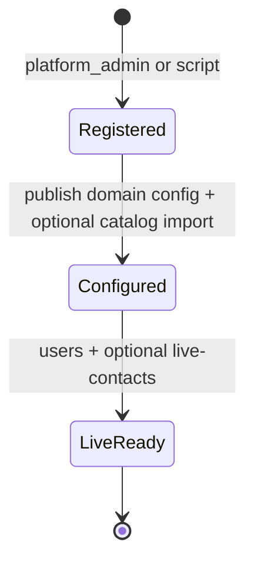

# Approach: Tenant lifecycle and multi-domain provisioning

**Status:** Proposed (not implemented)  
**Parent:** [desk-settings-approach.md](desk-settings-approach.md)  
**Related:** ADR-002 (pooled multi-tenancy), ADR-013, ADR-034, `oerf/platform/tenancy/dynamo_config.py`, `domains/`, `docs/interfaces.md` §2 and §6  
**Not here:** Day-to-day catalog edits → [settings-tenant-catalog-approach.md](settings-tenant-catalog-approach.md). Live numbers → [settings-live-contacts-approach.md](settings-live-contacts-approach.md).

## 1. Goal

Define how **new tenants** enter the platform when:

- **t1** runs the **cold chain excursion** domain (today’s MVP).
- **Future tenants** may subscribe to **other domains** (e.g. e-commerce fulfilment exceptions, on-call / “PagerDuty-style” escalation)—each domain is a **playbook package**: schema, defaults, state machine, message catalog (ADR-002).

**Explicit non-goal for this release:** a **self-service onboarding portal** or marketing signup. Provisioning is **platform-operated** (scripts and/or a narrow `platform_admin` API), then **tenant admins** use Settings for catalog data (companion docs).

## 2. Concepts (aligned with ADR-002)

| Concept | Meaning |
|---------|---------|
| **Tenant** | Isolation boundary: `tenant_id` on every key, log, execution name |
| **Domain** | Product playbook shipped in `domains/{name}/` (e.g. `cold_chain_excursion`) |
| **Subscription** | Tenant `META.domains[]` lists which playbooks apply |
| **Tenant config** | Overrides merged onto domain defaults, versioned `CONFIG#{domain}#v{n}` |
| **Reference data** | Contacts, facilities, shipments, etc. — per tenant, often domain-flavoured but stored on tenant table |

One deployment serves all tenants (pooled). Identity on requests: Cognito `custom:tenant_id`, device registry, or stored incident/engagement — never from an unauthenticated body field.

### 2.1 Example futures (design placeholders)

| Tenant (illustrative) | Primary domain(s) | Differentiating data |
|------------------------|-------------------|----------------------|
| `t1` (today) | `cold_chain_excursion` | Facilities, temperature profiles, drivers |
| `t-ecom` (future) | `ecommerce_fulfilment` (hypothetical) | SKUs, warehouses, courier roles |
| `t-sre` (future) | `incident_escalation` (hypothetical) | Services, on-call rotations, severity ladders |

**None of the hypothetical domains exist in `domains/` yet.** Lifecycle design must **register** a tenant against **domain names that exist in the repo** (or in platform table templates) and fail closed if the domain package is missing.

## 3. What exists today

### 3.1 Database

| Item | Content |
|------|---------|
| `TENANT#{tid}` / `META` | `tenant_id`, `domains` (JSON list), optional `brand_name`, `timezone`, `demo`, `clock_multiplier` from seed |
| `CONFIG#{domain}#…` | Published/draft config per subscribed domain |
| Platform `DOMAIN#{d}` / `TEMPLATE#v{n}` | Pattern 16 in `interfaces.md` (platform table) — domain templates; cold chain also ships under `domains/` in the Lambda package |

`DynamoConfigRepository.register_tenant(tenant_id, domains)` writes **META only** (minimal). `list_tenant_ids()` scans META rows.

### 3.2 API

- `GET /admin/tenants` — `platform_admin` lists tenant ids (when repository wired).
- `POST /admin/tenants` — body `{ "tenant_id", "domains": ["cold_chain_excursion", …] }` → `register_tenant` + audit.

No API yet for: Cognito users, initial catalog rows, state machine binding per domain, or SSM paths.

### 3.3 Scripts

- `scripts.seed_runtime` — imports `sim/seed` for **known demo tenants** only (`DEMO_TENANTS`).
- `scripts.seed_demo_users` — Cognito users with `custom:tenant_id`.
- CDK / deploy — `demo:seedDevices`, cold-chain state machine ARN on ingest (today **hard-coded** `DOMAIN = "cold_chain_excursion"` in ingest).

### 3.4 Gaps for real multi-domain

| Gap | Impact |
|-----|--------|
| Ingest picks one domain / one state machine ARN | New domains need ingest → domain resolution |
| Only `cold_chain_excursion` in `domains/` | New verticals need new domain packages + deploy |
| `register_tenant` does not seed catalogs | Empty tenant until script or Settings |
| No platform table workflow for template version | Templates read from package files today |

## 4. Target lifecycle (no onboarding portal)

### 4.1 Phases of a new tenant



| Step | Actor | Action | System of record |
|------|-------|--------|------------------|
| **1. Register** | Platform operator / `POST /admin/tenants` | Choose `tenant_id`, `domains[]` | `META` |
| **2. Validate domains** | Backend | Each domain exists (`domains/{name}/schema.json` or platform template) | Fail 400 if unknown |
| **3. Bootstrap config** | Script or API | Publish `v1` config from domain defaults + tenant overrides | `CONFIG#…` |
| **4. Bootstrap catalog** | Script, import, or Settings later | Contacts, facilities, domain-specific entities | Tenant + routing tables |
| **5. Identity** | `seed_demo_users` or IdP process | Cognito users in `tenant_admin` / `ops_user` with `custom:tenant_id` | Cognito |
| **6. Channels (optional)** | Live-contacts Settings or SSM script | Demo numbers per stage | SSM + `PHONE#` |
| **7. Ingest (if applicable)** | Register devices / webhooks | Map devices to tenant + shipment or domain-specific entity | Routing `DEVICE#` |

Steps 1–5 are **backend/script** for now. Steps 6–7 may use Settings (other docs).

### 4.2 What we do **not** build now

- Public signup, billing, or tenant chooser on login
- Schema-generated full admin portal (ADR-009 deferred)
- Automatic Step Functions / stack per tenant

## 5. Backend design: register and provision

### 5.1 Minimal register (already sketched)

Extend `POST /admin/tenants` validation:

- `tenant_id` format (e.g. `^[a-z][a-z0-9_-]{1,31}$`)
- `domains` non-empty; each domain **registered in platform catalog**
- Idempotent: re-POST same tenant updates `domains` list or returns 409 — **product choice**
- Optional body fields (future): `brand_name`, `timezone`, `primary_domain` for desk branding

**Do not** accept phone numbers or secrets in register body.

### 5.2 Provisioning service (recommended new module)

A single **platform-side** orchestrator (Lambda invoked only by `platform_admin`, or **CLI script** `scripts.provision_tenant`) with explicit `--dry-run` and `--yes`:

```
provision(tenant_id, domains, *, import_from: Path | None, create_users: bool)
```

Ordered side effects:

1. `register_tenant` → META  
2. For each domain: merge defaults → validate schema → publish config v1 (or leave draft for tenant admin)  
3. If `import_from`: apply catalog rows (today’s `seed_runtime` logic, generalized beyond `DEMO_TENANTS`)  
4. If `create_users`: call Cognito admin APIs (mirror `seed_demo_users`)  
5. Write `AUDIT#` row on tenant table  
6. **No** SSM unless `--live-contacts` flag (keep channel concerns separate)

Idempotent where possible (conditional puts, compare-and-swap on version).

### 5.3 Multi-domain rules

| Rule | Detail |
|------|--------|
| **Subscription** | `META.domains` is authoritative; APIs reject config publish for unsubscribed domain |
| **Primary domain** | Ingest/event routing needs a resolver: e.g. `primary_domain` on META, or infer from shipment/device row |
| **State machines** | Today one cold-chain machine; future: map `domain → STATE_MACHINE_ARN` in env or SSM platform settings |
| **Desk** | UI may filter Settings tabs by subscribed domains (hide cold-chain facilities for a pure e-com tenant) |
| **Party roles** | Domain schema documents allowed `party_role` values; catalog validation references domain, not global enum in code |

### 5.4 Data model extensions (proposed)

Additive fields on `META` (contract bump when implemented):

| Field | Purpose |
|-------|---------|
| `brand_name` | Desk display |
| `timezone` | Quiet hours, reporting |
| `primary_domain` | Default for ingest/UI when multiple subscribed |
| `status` | `active` \| `suspended` (optional) |
| `provisioned_at` / `provisioned_by` | Audit |

Platform table (optional, later):

| Key | Purpose |
|-----|---------|
| `DOMAIN#{name}` / `TEMPLATE#v{n}` | Register deployable domain versions; ingest/desk resolve “latest” |

Until platform rows exist, **packaged `domains/`** in the Lambda artifact remains source of schema/defaults.

## 6. Cognito and users

- Users are **not** created by tenant self-service.
- Provisioning script creates pool users with `custom:tenant_id` and group (`tenant_admin`, `ops_user`).
- `platform_admin` may belong to multiple tenants only if product allows (today: platform_admin wins group claim; tenant claim is single-valued).

## 7. Relationship to `sim/seed`

| Use | Approach |
|-----|----------|
| New **demo** tenant in hackathon | Copy `sim/seed/t1` template → new folder OR `provision_tenant --import sim/seed/t1` |
| New **production-style** tenant | No repo JSON; provision with defaults + Settings |
| t1/t2/sbx | Keep seeds for CI; lifecycle treats them as **imports**, not special cases in code forever |

Generalize `DEMO_TENANTS` allow-list to **registered** tenants in Dynamo.

## 8. Infrastructure and security

| Concern | Approach |
|---------|----------|
| Who can register | `platform_admin` only on API; script uses operator profile |
| IAM | Provisioning script uses broad creds; **no** tenant_admin path to create tenants |
| Cross-tenant | `register_tenant` never runs from tenant-scoped JWT |
| Secrets | WABA, phone-number-id stay platform SSM, not per-tenant META |

## 9. Phases

| Phase | Deliverable |
|-------|-------------|
| **L0** | Document domain validation rules; extend `POST /admin/tenants` validation + tests |
| **L1** | `scripts.provision_tenant` (register + publish defaults + optional import) |
| **L2** | Generalize `seed_runtime` import for any registered tenant |
| **L3** | Ingest **domain resolver** (device/shipment → domain → state machine ARN) |
| **L4** | Second domain package (proves multi-domain); platform template registry if needed |
| **L5** | Optional: internal “Provision tenant” desk page for `platform_admin` only (not public onboarding) |

Settings UI for catalogs starts in **catalog doc P1**, independent of L1.

## 10. Acceptance

1. Platform operator registers `t-new` with `["cold_chain_excursion"]` via script or API; META appears; config v1 validates against schema.
2. Import or Settings can add contacts; incidents can open for that tenant when ingest/device wired.
3. Attempt to register unknown domain `ecommerce_fulfilment` **fails** until package exists.
4. t1 behaviour unchanged after migration to provisioned model.
5. No tenant creation endpoint for `tenant_admin`.

## 11. Open questions

1. **Single vs multiple domains per tenant** in MVP — allow list on META only, or one primary?
2. **Config v1** auto-publish vs draft for tenant admin on first login?
3. **Tenant id** namespace — shared pool with `sbx` or separate prefix for prod?
4. **State machine** map — env var JSON vs platform table vs one machine per domain stack?
5. **When to add** first non-cold-chain domain — product priority vs platform abstractions first?

---

*Planning only. New domains require `domains/` packages, ingest/orchestration work, and contract updates — not just META rows.*
